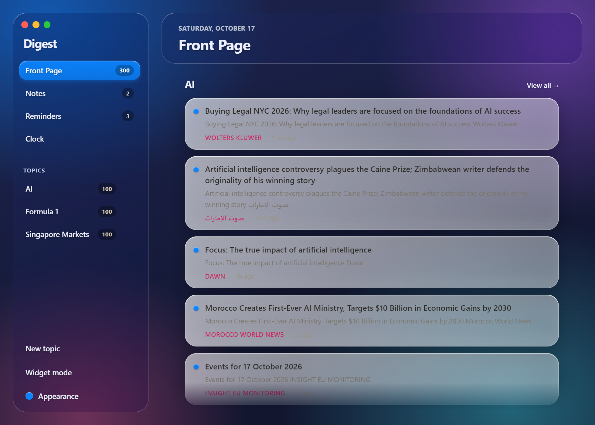
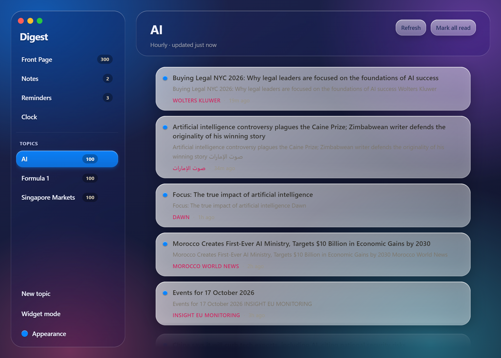
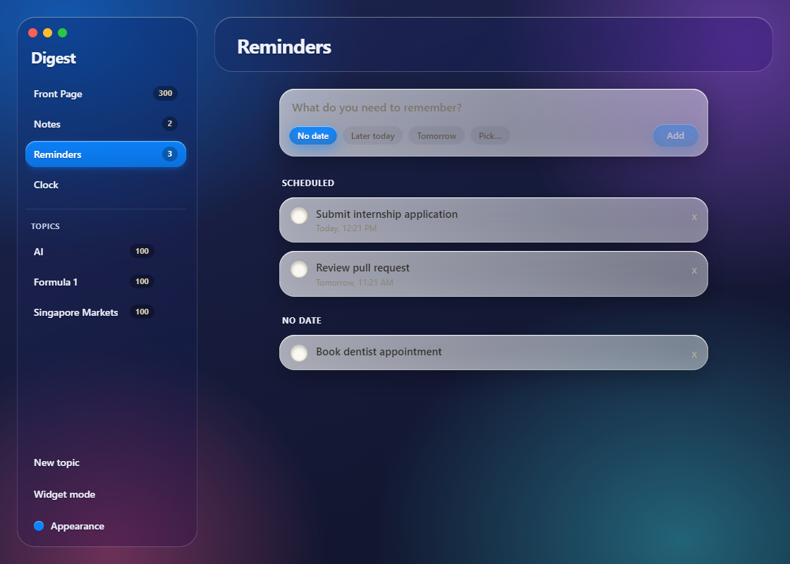
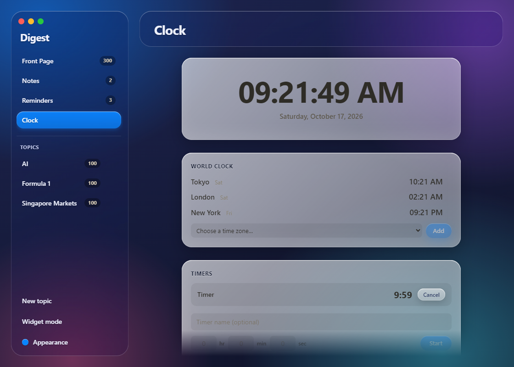
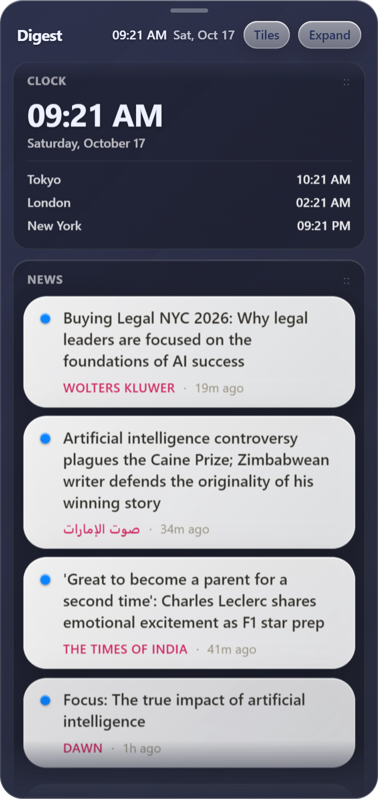

# Digest

A local-first desktop app that pulls keyword-driven news on background schedules and keeps your notes, reminders, world clock and timers in one place. No accounts, no backend, no API keys. Everything lives in a single JSON file you can back up.

Built with Electron, React, TypeScript and Tailwind, with a hand-made "liquid glass" design system.



## Download

Grab the Windows installer from the [latest release](https://github.com/emperorgaodi/digest/releases/latest) (`Digest Setup 1.0.0.exe`).

The installer is unsigned, so Windows SmartScreen will warn you the first time. Click **More info**, then **Run anyway**. If you would rather not run an unsigned binary, build it yourself (see below).

## Features

- **Topic tabs** - a name plus keywords builds a Google News RSS search. Each tab refreshes on its own schedule (hourly, every 6 hours, or daily), with deduplication and read/unread state that survives refreshes and restarts.
- **Front Page** - the newest items from every topic merged into one feed.
- **Notes** - autosaved as you type, with soft delete and restore.
- **Reminders** - quick presets or a custom-built date/time picker; due reminders fire a native desktop notification.
- **Clock** - live clock, a world clock for any time zones you add, and multiple named countdown timers (hours, minutes, seconds) that notify when they finish.
- **Widget** - a frameless always-on-top mini window. Its Clock, News, Reminders and Notes tiles can be dragged to reorder and hidden or shown.
- **Themeable** - nine accent colours that apply live across the whole UI.

| Topic feed | Reminders |
| --- | --- |
|  |  |

| Clock and timers | Widget |
| --- | --- |
|  |  |

## Run from source

```bash
npm install
npm run dev        # launches the app (Vite + Electron)
```

## Build the installer

```bash
npm run package    # writes the Windows installer to dist/
```

## Where your data lives

`%APPDATA%\digest\data.json` holds your topics, settings, items, notes and reminders as plain JSON. Copy it to back up, delete it to start fresh. "Open data folder" in the Appearance menu jumps straight to it.

## How it works

- **Two processes.** The Electron main process owns `data.json`, all RSS fetching, the per-tab schedulers and reminder checks. The React renderer is a pure view that talks to main through a small `contextBridge` API (`window.digest`) with context isolation on.
- **One store, many views.** Main mutates `data.json`, then pushes the full state to every open window. The Front Page, topic views and widget are live projections of the same data, so marking something read anywhere updates everywhere.
- **Safe persistence.** Writes go to a temp file and are renamed into place, so a crash mid-write cannot corrupt your data. Older data files gain new fields through default-merging on load.
- **Live scheduling.** One `setTimeout` per tab, re-armed on every change, so editing a tab's interval takes effect without a restart.
- **Fetching in main.** Feeds are fetched in the main process, so there is no CORS problem and no key to manage.

## Code map

```
electron/
  main.ts       windows, IPC, fetch -> merge -> persist -> broadcast loop
  store.ts      atomic JSON read/write, default-merge migration
  feeds.ts      Google News RSS URL and parsing
  scheduler.ts  per-tab timers, live reschedule
  types.ts      the AppData shape persisted to disk
  preload.ts    the window.digest API exposed to the renderer
src/
  App.tsx       app vs widget routing
  index.css     the glass design system
  components/   Sidebar, Digest, TabView, Notes, Reminders, Clock, Widget,
                DateTimePicker, ArticleCard, TabEditor
```

## Limitations

- Windows is the tested platform. The code is cross-platform, but macOS builds have not been tried.
- No automated tests yet.
- Timers do not survive an app restart.
